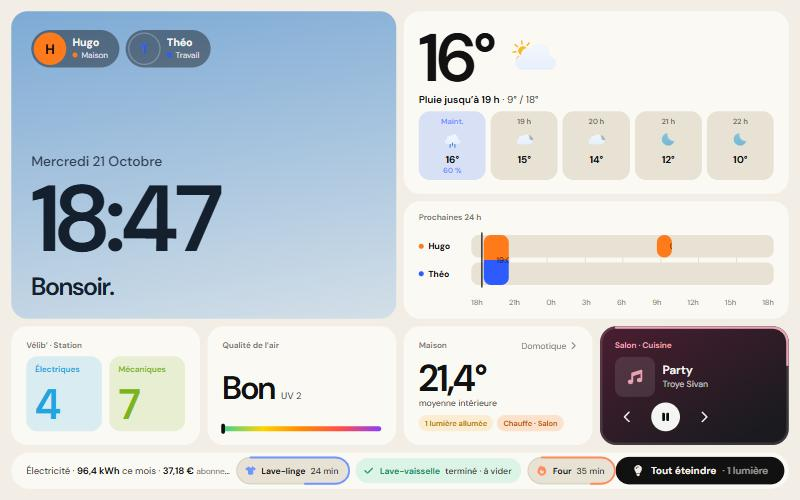

# Home Screen, a Home Assistant dashboard for a locked-down Android photo frame

🇬🇧 English · [🇫🇷 Français](#home-screen-un-tableau-de-bord-home-assistant-pour-cadre-photo-android)

**Live demo (fictional household): <https://coinc.fr/dev/wall-frame/>**

[](https://coinc.fr/dev/wall-frame/)

A full-screen dashboard for a locked-down Android photo frame (tested on a PF1007L: Allwinner A33, Android 6.0.1, WebView 106), driven by your Home Assistant. Plain JavaScript, built with Vite. The interface is in French.

This work starts from [wesbos/photo-frame-dashboard](https://github.com/wesbos/photo-frame-dashboard), whose guides explain how to get ADB, back up the firmware and replace the vendor app. They are in `docs/` at the root of this repository. Everything here is what runs on the frame once it is yours.

The dashboard lives in a fixed 1280×800 (landscape) or 800×1280 (portrait) scene, scaled to the screen.

## What it shows

- **Home**: clock whose background follows the sun and the weather, weather with rain chances, 24 h agenda per person, Vélib', air quality, a "house" card (average temperature, heating, air conditioning, lights, vacuum), a music card with the album cover, and a strip of pills for the appliances that are running.
- **Appliances**: oven, washing machine, dishwasher and coffee machine on a full-screen page, with one animation per step (pre-wash, wash, rinse, spin, drying, preheating, cooking…), remaining time and the current step. Several appliances are shown side by side (in rows in portrait).
- Full-screen **player**, **agenda** (day, 3 days, week, month), **home control** (rooms, heating, air conditioning) and a **standby screen** that also shows the running appliances.
- **Settings** by pressing and holding the clock: theme, brightness (light sensor with an adjustable curve), orientation, Wi-Fi.

## Try it without Home Assistant

```bash
cd photo-frame-dashboard/dashboard
npm install
npm run dev
```

Then open, for example:

- `http://localhost:5173/?view=home&m=linge:rinse,vaisselle:done,four:cook`
- `http://localhost:5173/?view=machines&m=linge:spin&sel=linge`
- `http://localhost:5173/?view=ambient&m=linge:wash`

Without a token, `js/demo-scenes.js` loads a fictional household. Possible steps for `m=`: `pre`, `wash`, `rinse`, `spin`, `dry`, `cook`, `brew`, `heat`, `done`.

## Connect your Home Assistant

1. Edit `js/config.js`: Home Assistant address, people, rooms, lights, sensors, appliances. The example ids do not exist in your installation. A card without entities hides itself.
2. In Home Assistant, create a non-administrator user and a **long-lived access token** (Profile → Security). The token is never in the code: give it once with `?ha_token=…` in the address, it is kept in the browser and removed from the address bar. On the frame, `../tools/set-ha-token.ps1` hands it to the kiosk without leaving it on the PC.
3. Build and publish: `../tools/deploy-to-ha.ps1` copies the dashboard to `www/cadre` of Home Assistant (Samba share). It is then served at `http://<home-assistant>:8123/local/cadre/index.html`.

Supported appliances out of the box: Samsung oven and washing machine through the LocalThings integration, Bosch dishwasher and coffee machine through Home Connect. Other brands need `syncMachines()` in `js/ha.js` to be adapted.

## The Android kiosk

`kiosk/` is a small Android app (full-screen WebView, brightness, orientation, Wi-Fi). `../tools/build-kiosk.ps1` builds it without Gradle (aapt2, javac, d8, apksigner) from an `android-build/` folder holding an SDK, a JDK and a debug key. Install it with `adb install -r android-build/kiosk-build/homehq.apk`. Change `DEFAULT_URL` in `MainActivity.java`.

## Privacy

- The dashboard only talks to Home Assistant. Fonts and icons are in the repository, nothing is loaded from the Internet.
- The token is stored in the browser or the kiosk, never in a file of the repository.
- `?anon` hides one person and the name of the Vélib' station (screenshot mode, set in `js/config.js`).

## Credits

Based on [wesbos/photo-frame-dashboard](https://github.com/wesbos/photo-frame-dashboard) (research on Android frames, base kiosk). Font Awesome Free icons (see `public/FONTAWESOME-LICENSE.txt`), animated Meteocons weather, DM Sans font (OFL).

---

# Home Screen, un tableau de bord Home Assistant pour cadre photo Android

[🇬🇧 English](#home-screen-a-home-assistant-dashboard-for-a-locked-down-android-photo-frame) · 🇫🇷 Français

**Démo en ligne (maison fictive) : <https://coinc.fr/dev/wall-frame/>**

[](https://coinc.fr/dev/wall-frame/)

Un dashboard plein écran pour un cadre photo Android verrouillé (testé sur un PF1007L : Allwinner A33, Android 6.0.1, WebView 106), piloté par votre Home Assistant. JavaScript sans framework, construit avec Vite. L'interface est en français.

Ce travail part de [wesbos/photo-frame-dashboard](https://github.com/wesbos/photo-frame-dashboard), dont les guides expliquent comment obtenir ADB, sauvegarder le firmware et remplacer l'application d'origine. Ils se trouvent dans `docs/` à la racine de ce dépôt. Ici, c'est ce qui tourne sur le cadre une fois qu'il est à vous.

Le dashboard tient dans une scène fixe de 1280×800 (paysage) ou 800×1280 (portrait), mise à l'échelle de l'écran.

## Ce que ça affiche

- **Accueil** : horloge dont le fond suit le soleil et la météo, météo avec chances de pluie, agenda des 24 h par personne, Vélib', qualité de l'air, carte « Maison » (température moyenne, chauffage, clim, lumières, aspirateur), carte musique avec pochette, et une bande de pastilles pour les appareils en route.
- **Électroménager** : four, lave-linge, lave-vaisselle et machine à café sur une page plein écran, avec une animation par étape (prélavage, lavage, rinçage, essorage, séchage, préchauffage, cuisson…), le temps restant et l'étape en cours. Plusieurs appareils s'affichent côte à côte (en lignes en portrait).
- **Lecteur** plein écran, **agenda** (jour, 3 jours, semaine, mois), **domotique** (pièces, chauffage, clim) et **écran de veille** qui montre aussi les appareils en cours.
- **Réglages** par appui long sur l'heure : thème, luminosité (capteur de lumière avec courbe réglable), orientation, Wi-Fi.

## Essayer sans Home Assistant

```bash
cd photo-frame-dashboard/dashboard
npm install
npm run dev
```

Puis ouvrez par exemple :

- `http://localhost:5173/?view=home&m=linge:rinse,vaisselle:done,four:cook`
- `http://localhost:5173/?view=machines&m=linge:spin&sel=linge`
- `http://localhost:5173/?view=ambient&m=linge:wash`

Sans jeton, `js/demo-scenes.js` charge une maison fictive. Étapes possibles pour `m=` : `pre`, `wash`, `rinse`, `spin`, `dry`, `cook`, `brew`, `heat`, `done`.

## Brancher votre Home Assistant

1. Modifiez `js/config.js` : adresse de Home Assistant, personnes, pièces, lumières, capteurs, appareils. Les identifiants d'exemple n'existent pas chez vous. Une carte sans entité se masque.
2. Dans Home Assistant, créez un utilisateur non administrateur et un **jeton d'accès longue durée** (Profil → Sécurité). Le jeton n'est jamais dans le code : donnez-le une fois avec `?ha_token=…` dans l'adresse, il est gardé dans le navigateur puis retiré de l'adresse. Sur le cadre, `../tools/set-ha-token.ps1` le transmet au kiosque sans le laisser sur le PC.
3. Construisez et publiez : `../tools/deploy-to-ha.ps1` copie le dashboard dans `www/cadre` de Home Assistant (partage Samba). Il est alors servi sur `http://<home-assistant>:8123/local/cadre/index.html`.

Appareils pris en charge par défaut : four et lave-linge Samsung via l'intégration LocalThings, lave-vaisselle et machine à café Bosch via Home Connect. D'autres marques demandent d'adapter `syncMachines()` dans `js/ha.js`.

## Le kiosque Android

`kiosk/` est une petite application Android (WebView plein écran, luminosité, orientation, Wi-Fi). `../tools/build-kiosk.ps1` la compile sans Gradle (aapt2, javac, d8, apksigner) à partir d'un dossier `android-build/` contenant un SDK, un JDK et une clé de debug. Installation : `adb install -r android-build/kiosk-build/homehq.apk`. Adaptez `DEFAULT_URL` dans `MainActivity.java`.

## Vie privée

- Le dashboard ne parle qu'à Home Assistant. Les polices et les icônes sont dans le dépôt, rien n'est chargé depuis Internet.
- Le jeton est stocké dans le navigateur ou le kiosque, jamais dans un fichier du dépôt.
- `?anon` masque une personne et le nom de la station Vélib' (mode capture d'écran, réglé dans `js/config.js`).

## Crédits

Basé sur [wesbos/photo-frame-dashboard](https://github.com/wesbos/photo-frame-dashboard) (recherche sur les cadres Android, kiosque de base). Icônes Font Awesome Free (voir `public/FONTAWESOME-LICENSE.txt`), météo animée Meteocons, police DM Sans (OFL).
